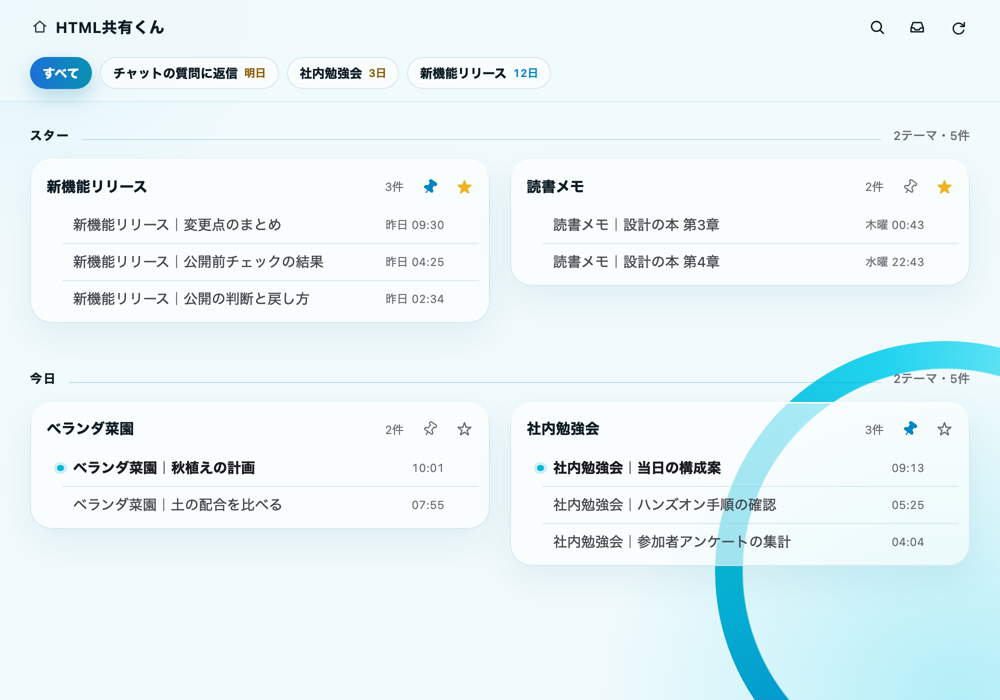
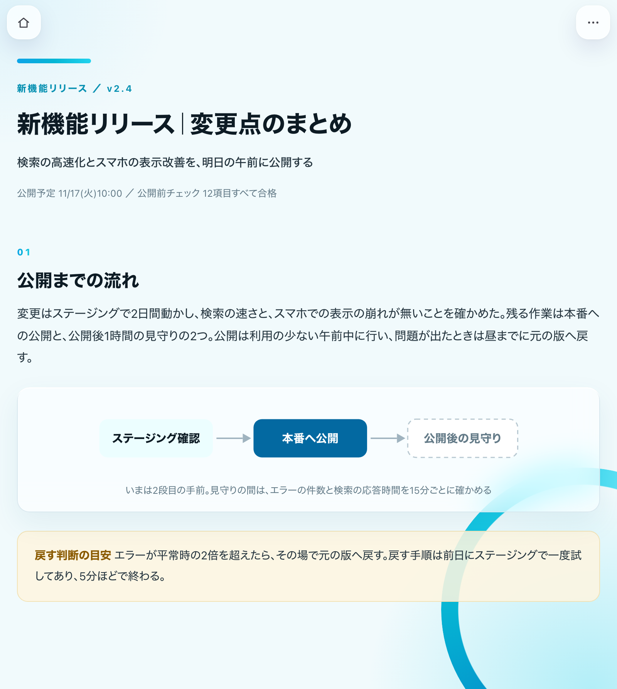
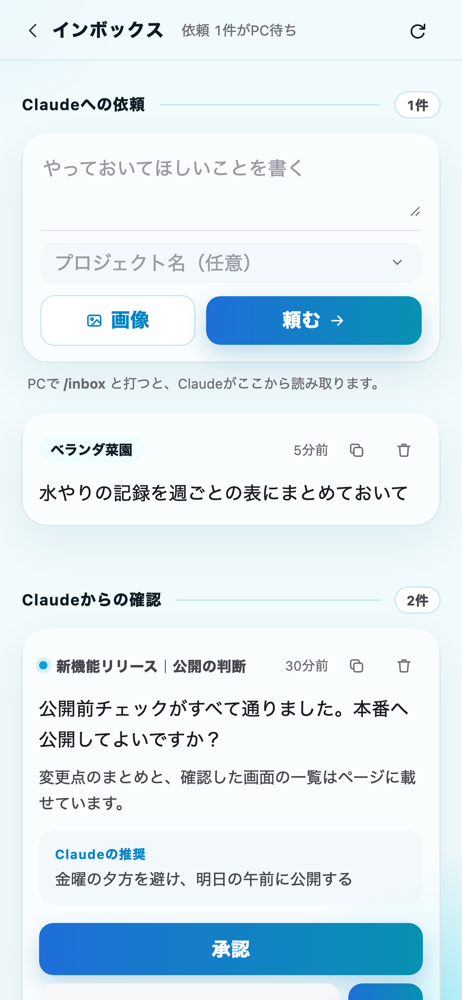

# HTML共有くん

HTML共有くんは、AIコーディングエージェントに作らせたHTMLを1か所にためて、スマホからも読めるようにするツールです。自分のAWSアカウントで動かすセルフホスト型なので、ページや回答が作者に送られることはありません。

  

  
  &nbsp;
  

## 主な機能

- **ためる**：エージェントが作ったHTMLを自分専用の一覧に登録して配信する。画像やフォントは1枚に埋め込むので、リンクが切れない
- **見つける**：同じ案件のページを1枚のカードにまとめ、新着・スター・進行中の仕事で絞り込める
- **スマホで読む**：ホーム画面に追加すればアプリのように開ける。はみ出す表やカレンダーはスマホ幅に並べ直す
- **共有する**：期限付きの共有URLをその場で発行できる。社内限定のURLも選べ、SlackやTeamsに貼るとカードで表示される
- **古いページをしまう**：更新が止まったページを決めた日数で配信から外し、保管庫にタイトルだけ残す。共有URLもそこで開けなくなり、要るときは1コマンドで戻せる
- **スマホとやり取りする**：外出先で思いついた依頼を置いておいたり、PCの確認依頼にスマホから答えたりできる
- **スマホの画像を渡す**：スクリーンショットや写真を依頼に添えて、PCのエージェントに読ませられる

## 頼み方の例

セットアップが済んだあとは、いつもどおりエージェントに日本語で頼みます。コマンドは覚えなくてOKです。

> このHTMLを共有くんに追加して

> このページを社内限定で7日間共有して

> `/inbox` で、スマホから置いた依頼を引き取って

Claude Code、Codex、Cursorなど、手元のどのエージェントからでも同じように使えます。

## AWSの構成

  

エージェントが作ったHTMLを配る閲覧面と、一覧やインボックスを出す管理面を、別々のCloudFrontとドメインに分けています。手元のCLIはページと画面をS3に直接送り、ブラウザは署名付きURLやCookieで開きます。詳しくは[アーキテクチャ](docs/architecture.md)を参照してください。

## ドキュメント

- [初回セットアップ](docs/setup.md)
- [アーキテクチャ](docs/architecture.md)
- [セキュリティ設計](docs/threat-model.md)
- [進行中フィルター](docs/progress-filter.md)
- [保持期限と保管庫](docs/retention.md)
- [大きな図の全画面表示](docs/figure-zoom.md)
- [リンクプレビュー（OGP）](docs/link-preview.md)
- [画面のテーマとページの既定スタイル](docs/site-theme.md)

## ライセンス

Apache License 2.0
